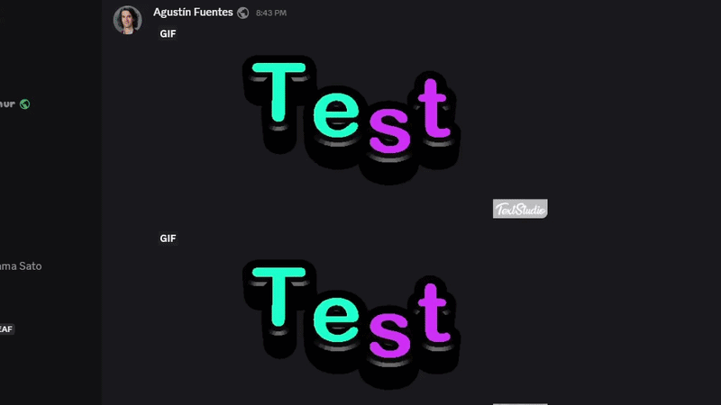

# HideMediaEverywhere

Hide specific images, GIFs, and videos anywhere they appear in Discord.

HideMediaEverywhere is a Vencord userplugin. Right-click a message or image and choose **Hide this media**. The plugin covers the media with a placeholder and leaves the rest of the message visible.

## Features

- Hides one image, GIF, video, or a message's media attachments.
- Keeps matching media hidden across chats, search results, previews, and the GIF picker.
- Recognizes supported images by content, even when Discord changes the URL.
- Matches Discord-hosted videos across channels when Discord preserves the filename.
- Lets you drag down on a placeholder to peek at the hidden media.
- Supports a custom placeholder image and optional filename tooltips.
- Adds matching **Unhide** actions to restore hidden media.

## Demo



## Install

You need a [Vencord source installation](https://docs.vencord.dev/installing/) before installing custom plugins.

From the root of your Vencord source folder:

```sh
git clone https://github.com/t6rtar/HideMediaEverywhere.git src/userplugins/hideMediaEverywhere
pnpm build
```

Install or select the custom build for your Discord client. Quit the client from its tray or taskbar icon, reopen it, then enable **HideMediaEverywhere** under **Settings > Vencord > Plugins**.

See [docs/installation.md](docs/installation.md) for client-specific installation, updating, removal, and troubleshooting.

## Use

1. Right-click a message containing media, or right-click an individual image.
2. Choose **Hide this media**, **Hide this image**, or **Hide all media**.
3. Use the matching **Unhide** action when you want it visible again.

Vencord saves your hidden-media settings on your device. The plugin does not delete messages or change what other people see.

## Settings

- **Drag to peek:** Drag the placeholder down to reveal the media until you release it.
- **Autoplay GIFs:** Start GIF playback when you reveal the media.
- **Show media filename:** Show the original filename or URL when hovering over hidden media. Uses Vencord's `ImageFilename` plugin.
- **Placeholder image:** Choose an image to display in place of hidden media.

## Support

Before opening an issue, update and rebuild Vencord. Quit Discord or Vesktop from its tray or taskbar icon, reopen it, and check the [troubleshooting guide](docs/installation.md#troubleshooting).

When reporting a bug, include:

- Discord or Vesktop and its version
- Vencord commit or version
- The type of media that failed
- Whether the problem happens in chat, search, a preview, or the GIF picker
- Steps that reproduce the problem without private messages or personal media

## Compatibility

Discord and Vencord updates can break the plugin. Use the current source; old tags remain available for reference.

## Development

The plugin source is [index.tsx](index.tsx). Test changes from a Vencord source checkout with:

```sh
pnpm testTsc
pnpm build
```

See [CONTRIBUTING.md](CONTRIBUTING.md) before submitting a bug fix or change.

## License

HideMediaEverywhere is licensed under [GPL-3.0-or-later](LICENSE).
